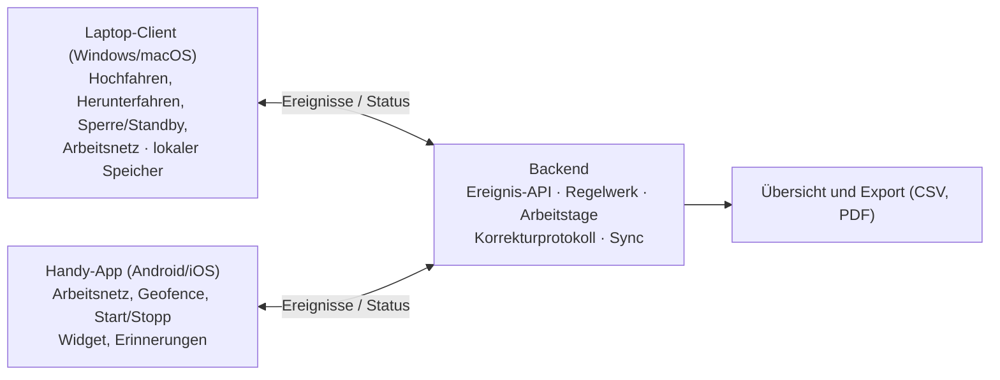

# Konzept: Automatische Zeiterfassungs-App

Stand: 19.10.2026

## Ziel & Überblick

Die App erfasst Arbeitszeit weitgehend automatisch über drei Signale – Arbeitsnetz (WLAN oder LAN/Dockingstation), Hochfahren/Herunterfahren des Laptops und manuelle Eingabe – und führt alles zu einem Tageseintrag zusammen. Der Nutzer korrigiert nur noch Ausnahmen, statt jeden Tag zu stempeln.

- **Plattformen:** Desktop-Client (Windows und macOS von Anfang an) und Mobile-App (Android, iOS), synchronisiert über ein gemeinsames Konto.
- **Zielgruppe:** Zwei Editionen – eine Privat-App für Einzelne (Angestellte, Freiberufler) und eine Firmenversion mit Admin-Bereich und Freigabe durch Vorgesetzte.
- **Grundprinzip:** Jedes Gerät meldet nur *Ereignisse* (z. B. „WLAN verbunden 08:02“). Ein zentraler Regelwerk-Dienst berechnet daraus Arbeitsbeginn und -ende. So widersprechen sich Laptop und Handy nie.

## Erfassungslogik

Arbeitsbeginn ist das **früheste** gültige Start-Ereignis des Tages, Arbeitsende das **späteste** gültige End-Ereignis. Manuelle Einträge haben immer Vorrang vor automatischen.

| Ereignis | Quelle | Wirkung | Zeitstempel |
| --- | --- | --- | --- |
| Arbeitsnetz verbunden (WLAN, LAN, Geofence) | Laptop oder Handy | Start | Verbindungszeitpunkt |
| Laptop hochgefahren / angemeldet | Laptop | Start | Einschaltzeit, rückwirkend gebucht, sobald der Laptop 5 min läuft |
| Manuell „Arbeit beginnen“ | beide | Start (überschreibt) | eingegebene Zeit |
| Arbeitsnetz getrennt | Laptop oder Handy | Ende | Trennungszeitpunkt (nach Karenzzeit, s. Sonderfälle) |
| Laptop heruntergefahren | Laptop | Ende | Shutdown-Zeit + 5 min Puffer |
| Manuell „Arbeit beenden“ | beide | Ende (überschreibt) | eingegebene Zeit |

**Regeln**

1. Ein Start-Ereignis öffnet eine Sitzung nur, wenn keine offen ist; weitere Starts werden protokolliert, ändern den Beginn aber nicht.
2. **Pausen am Laptop**: Ist der Laptop 15 min oder länger inaktiv (Standby, Deckel zu, Bildschirm gesperrt), ist das eine Pause. War es doch Arbeit (z. B. Meeting ohne Laptop), reicht ein Tipp auf „war Arbeit“. Ohne Laptop gelten Netz-Lücken über 10 min als Pause.
3. Eine Lücke über 2 h trennt zwei Sitzungen. Die erste Sitzung des Tages zählt automatisch, jede weitere (z. B. Laptop abends privat eingeschaltet) erst nach Bestätigung. Dasselbe gilt für Sitzungen an Tagen ohne Sollzeit (Wochenende).
4. Standby und Deckel zu beenden keine Sitzung. Dauert die Inaktivität länger als 3 h, endet die Sitzung bei der letzten Aktivität und der Tag wird zur Prüfung markiert – so entstehen keine Sitzungen über mehrere Tage. Sitzungen über 16 h werden abgeschnitten und markiert.
5. Startpuffer: Der Laptop muss 5 min laufen, dann wird rückwirkend die Einschaltzeit gebucht. Beim Herunterfahren werden 5 min aufgeschlagen (in der Firmenversion einstellbar, auch 0). Neustart, Absturz mit sofortigem Neustart und Logout sind nie ein Arbeitsende.
6. Manuell: Start/Stopp per Knopf funktioniert auch ganz ohne Laptop und Netz. Nachträgliche Eingaben sperren den jeweiligen Wert – Automatik darf ihn danach nicht mehr verschieben.
7. Jedes Ereignis trägt seine Quelle; im Tagesprotokoll ist immer sichtbar, *warum* eine Zeit gesetzt wurde.
8. Pausenpflicht: Gemessen wird an der tatsächlichen Arbeitszeit. Zur Mindestpause zählen nur Stücke ab 15 min. Fehlt Pause, wird die Differenz als eigener Posten abgezogen und der Tag als Pausenverstoß markiert; ebenso, wenn mehr als 6 h am Stück ohne Pause gearbeitet wurde. Die tatsächlichen Zeiten bleiben unverändert gespeichert, das Netto wird nie negativ.

## Sonderfälle

Die meisten Fehlbuchungen entstehen durch kurze Unterbrechungen; deshalb braucht jede automatische Ende-Erkennung eine Karenzzeit.

| Situation | Verhalten |
| --- | --- |
| WLAN bricht kurz ab (Router, Funkloch) | Bis 10 min überbrückt |
| Mittagspause, Laptop zugeklappt oder gesperrt | Inaktivität ≥ 15 min = Pause, automatisch erkannt |
| Mittagspause außer Haus ohne Laptop (nur Handy) | Netz-Lücke > 10 min = Pause; zählt zur Mindestpause, wenn ≥ 15 min |
| Meeting ohne Laptop | Wird zunächst als Pause erkannt; ein Tipp auf „war Arbeit“ korrigiert es |
| Laptop über Nacht zugeklappt (auch automatischer Ruhezustand) | Sitzung endet bei der letzten Aktivität am Abend; Tag zur Prüfung markiert |
| Laptop-Neustart, Windows-Update | Kein Ende – Neustart wird erkannt, sonst gilt ein Neustart-Fenster von 15 min (Update: 60 min) |
| Absturz mit sofortigem Neustart | Kein Ende, nur Hinweis im Protokoll |
| Stromausfall, Laptop bleibt aus | Ende = letzte Aktivität, ohne Aufschlag; Tag zur Prüfung markiert |
| Logout | Kein Ereignis |
| Laptop abends privat eingeschaltet | Zweite Sitzung, zählt erst nach Bestätigung |
| Arbeit am Wochenende / Feiertag | Sitzung zählt erst nach Bestätigung; Hinweis Sonn-/Feiertagsarbeit |
| Laptop per Kabel an Dockingstation, WLAN aus | Arbeitsnetz wird über Netzwerk-Kennung erkannt (ohne Standortberechtigung) |
| Handy im Büro-WLAN, Laptop zu Hause aus | Frühestes Start-Ereignis gilt, egal von welchem Gerät |
| Handy meldet kein Trennen (App beendet, Akku leer) | Ende = letzte Aktivität des Handys; Tag zur Prüfung markiert |
| Nur manuell erfasst (kein Laptop, kein Netz) | Start/Stopp per Knopf bildet die Sitzung |
| Homeoffice (kein Arbeitsnetz) | Laptop-Start greift; optional Homeoffice-Netz hinterlegen |
| Ende vergessen, Laptop läuft durch | Nach 10 h Erinnerung; nach 16 h abgeschnitten und markiert |
| Arbeit über Mitternacht | Sitzung wird auf beide Kalendertage aufgeteilt, auch über Monatsgrenzen; Pausenabzug landet nie als Minus auf einem Tag |
| Zeitumstellung | Dauern werden exakt berechnet (23-h- bzw. 25-h-Tag) |
| Dienstreise in anderer Zeitzone | Die Sitzung folgt der Zeitzone ihres Start-Ereignisses |
| Urlaub, Krankheit, Feiertag | Als Abwesenheit eintragen; Feiertage automatisch nach Bundesland; zählen im Saldo wie Sollzeit |
| Teilzeit, wechselnde Sollzeit | Sollzeiten je Wochentag mit Gültigkeitsdatum |
| Kein Netz beim Ereignis | Ereignis lokal speichern, später synchronisieren (Offline-first) |
| Shutdown am Freitag, übertragen am Montag | Normal, wird nicht markiert |
| Ereignis auf dem Gerät rückdatiert | Wird angenommen, aber als Nachtrag markiert und der Tag zur Prüfung gestellt |

## Funktionsumfang

Das MVP deckt genau die beschriebenen Trigger plus Korrektur und Export ab; alles Weitere kommt danach.

**MVP**

- Arbeitsnetze hinterlegen: WLAN per SSID oder Netzwerk-Kennung für LAN/Dockingstation (aktuelles Netz mit einem Tipp übernehmen)
- Automatischer Start/Ende über Arbeitsnetz und Laptop-Start/-Shutdown mit 5-min-Puffer
- Manuelle Start-/Stopp-Buttons, auch im Widget und in der Menüleiste/Taskleiste
- Tagesansicht mit Ereignisprotokoll, Bearbeiten-Funktion und „Tag bestätigen“
- Abwesenheiten (Urlaub, Krankheit) und Feiertage nach Bundesland
- Wochen-/Monatsübersicht mit Soll/Ist und Überstundensaldo
- Export als CSV und PDF, Datenauskunft und Kontolöschung
- Erinnerungen: „Ende vergessen?“, „Arbeitszeit > 10 h“, „Pause fehlt“, mit Ruhezeiten (keine Benachrichtigung nachts)
- Geführte Einrichtung inkl. Berechtigungen je Plattform
- Barrierefrei nach WCAG 2.1 AA

**Später**

- Feinere Pausenregeln (z. B. feste Pausenzeiten je Firma)
- Projekte/Kunden zuordnen
- Firmenversion: Admin-Bereich, Teams, Freigabe durch Vorgesetzte (fester Produktbestandteil, direkt nach dem MVP)
- Schnittstellen zu Lohnbuchhaltung (z. B. DATEV) und Kalender
- Geofence auch für Android (auf iOS bereits im MVP für das Arbeitsende)

## Technische Architektur

Zwei schlanke Clients sammeln Ereignisse, ein Backend wendet die Regeln an; so bleibt die Logik an einer Stelle und funktioniert auch, wenn ein Gerät offline war.

Der härteste Teil ist die Hintergrund-Erkennung auf dem Handy, weil beide Mobil-Systeme Apps im Hintergrund stark einschränken.

| Plattform | Erkennung | Einschränkung / Lösung |
| --- | --- | --- |
| Windows | Tray-App mit Autostart (kein Dienst); Herunterfahren über System-Nachricht (Logout herausgefiltert), echte Startzeit, Ruhezustand, Neustart und Absturz über das Systemprotokoll; Sperre/Standby für Pausen; Netzwechsel | WLAN-Name teils nur mit Standortfreigabe (Windows 11 24H2), die Firmen oft sperren → Netzwerk-Kennung als Standard |
| macOS | Tray-App mit Autostart; Grund des Beendens unterscheidet Herunterfahren, Neustart und Logout; Sperre/Standby für Pausen | WLAN-Name nur mit Ortungsdiensten → sonst Netzwerk-Kennung |
| Android | Netzwerk-Callback weckt die App auch, wenn sie beendet ist; Erkennung über Netzwerk-Kennung **ohne Standortberechtigung** | WLAN-Name nur optional (dann Hintergrund-Standort und Play-Deklaration); Akkusparmodi einzelner Hersteller |
| iOS | Verbinden über Kurzbefehle-Automation „WLAN“; Arbeitsende über Geofence (opt-in) oder den Laptop | Kurzbefehle kennen kein „Trennen“; Geofence braucht „Immer“-Standort und Begründung im App-Review. Ohne Laptop ist das Ende auf iOS unschärfer |

Tech-Stack: Desktop mit Tauri (Rust-Kern + React), Mobil mit React Native/Expo und eigenen nativen Modulen, Backend mit Node.js, Fastify und PostgreSQL in der EU. Details im Implementierungskonzept.

## Datenmodell

Gespeichert werden rohe Ereignisse und daraus berechnete Arbeitstage; so lässt sich jede Zeit jederzeit neu berechnen oder nachvollziehen.

| Entität | Wichtige Felder |
| --- | --- |
| Nutzer | ID, Name, Zeitzone, Bundesland (Feiertage), Rolle, Team |
| Sollzeit | Wochentag, Minuten, gültig ab (Teilzeit-Wechsel) |
| Abwesenheit | Datum, Art (Urlaub / Krankheit / Feiertag / sonstiges), Minuten |
| Gerät | ID, Nutzer, Typ (Laptop/Handy), Betriebssystem, zuletzt gesehen, gesperrt |
| Arbeitsnetz | Bezeichnung (Büro/Homeoffice), Art (WLAN-Name, Netzwerk-Kennung, Geofence), optional Router-Kennung gegen gefälschte gleichnamige Netze |
| Ereignis | ID, Gerät, Typ (Netz verbunden/getrennt, Hochfahren, Herunterfahren, Neustart, manuell, „war Arbeit“, Bestätigung), Quelle, Zeitstempel, Zeitzone, Eingang beim Server – unveränderlich |
| Arbeitstag | Datum, Sitzungen, Pausen, Pausen-Auffüllung, Netto, unbestätigte Zeit, Abwesenheit, Soll, Status (offen / ungeprüft / automatisch / bestätigt), korrigiert, Warnungen |
| Korrektur | Arbeitstag, erzeugtes Ereignis, alter Wert, neuer Wert, Zeitpunkt, Begründung |
| Freigabe | Monat, Status, Snapshot der Arbeitstage, Freigebende Person, Kommentar |

Zusätzlich speichert jedes Gerät **Aktiv-Spannen** (wach und entsperrt bzw. im Arbeitsnetz) als Zeiträume statt einzelner Lebenszeichen; daraus erkennt das Regelwerk Pausen und Sitzungsenden.

## UI-Konzept

Die App soll im Alltag unsichtbar bleiben; geöffnet wird sie nur zum Prüfen und Korrigieren.

1. **Heute** – großer Status („Seit 08:02 bei der Arbeit · Büro-Netz“), laufende Zeit, ein Button Start/Stopp.
2. **Tagesprotokoll** – Zeitleiste der Ereignisse mit Quelle-Symbol (Netz, Laptop, Hand); Tippen auf Beginn/Ende öffnet die Korrektur; Pausen-Auffüllung als eigener Posten sichtbar; erkannte Pausen lassen sich mit „war Arbeit“ umwandeln.
3. **Zu prüfen** – Liste ungeprüfter Tage und unbestätigter Sitzungen (abends, Wochenende, Standby, Pausenverstoß) mit „Bestätigen“ / „Verwerfen“.
4. **Übersicht** – Woche/Monat mit Soll/Ist-Balken, Überstundensaldo, Abwesenheiten, „ungeprüfte“ Tage hervorgehoben.
5. **Einstellungen** – Arbeitsnetze, Automatik je Auslöser an/aus, Sollzeiten, Bundesland, Erinnerungen und Ruhezeiten, Geräteverwaltung, Datenexport, Konto löschen.
6. **Einrichtungsassistent** – erklärt den Zweck jeder Berechtigung vor der Abfrage, übernimmt das aktuelle Netz, richtet auf iOS den Kurzbefehl ein, zeigt zum Schluss ein Testsignal.
7. **Desktop-Tray** – Icon in Menü-/Taskleiste mit aktueller Zeit und Schnellaktionen; kein eigenes Fenster nötig.
8. **Handy-Widget** – Status + Start/Stopp direkt vom Homescreen.

Alle Oberflächen sind tastatur- und screenreaderbedienbar und erfüllen WCAG 2.1 AA.

## Datenschutz & Recht

WLAN-Erkennung ist indirekt eine Standortüberwachung; die App muss deshalb sparsam erfassen und für Nutzer transparent sein.

- **Datensparsamkeit (DSGVO):** Nur prüfen, ob ein *hinterlegtes* Arbeitsnetz verbunden ist. Fremde Netznamen, Koordinaten oder App-Nutzung werden nie gespeichert oder übertragen. Netzwerk-Kennungen sind mit Nutzerbezug personenbezogen und werden nur als HMAC mit geheimem Schlüssel gespeichert.
- **Transparenz:** Jeder automatische Eintrag zeigt seine Quelle; Nutzer können Automatik pro Auslöser abschalten. Vorgesetzte sehen je Tag nur Beginn, Ende, Pause, Netto, Status und Warnungen – nie Sitzungsdetails, Quellen, Rohereignisse oder Gerätedaten.
- **Arbeitszeitgesetz:** Hinweise bei mehr als 10 h tatsächlicher Arbeitszeit, unter 11 h Ruhezeit, fehlender oder zu später Pause (30 min ab 6 h, 45 min ab 9 h, nur Stücke ab 15 min; nicht mehr als 6 h am Stück), Sonn-/Feiertagsarbeit und mehr als 8 h im Durchschnitt über 24 Wochen.
- **Echte Zeiten statt geschönter:** Tatsächliche Beginn-, End- und Pausenzeiten bleiben immer unverändert gespeichert. Eine Pausen-Auffüllung ist nur ein ausgewiesener Abzug mit Warnung, damit ein Pausenverstoß sichtbar bleibt.
- **Aufzeichnungspflicht:** Pflicht seit dem BAG-Beschluss vom 13.09.2022 (1 ABR 22/21). Der Referentenentwurf zum Arbeitszeitgesetz vom Juni 2026 (interne Arbeitsfassung, nicht beschlossen) sieht elektronische, taggleiche Erfassung von Beginn, Ende und Dauer vor, mit Übergangsfristen und einer Ausnahme für Betriebe bis 10 Beschäftigte – die App erfüllt das; Stand vor Release erneut prüfen. Korrekturen werden mit Begründung protokolliert, Rückdatierungen markiert.
- **Aufbewahrung & Löschung:** Privatkonten werden auf Wunsch sofort vollständig gelöscht (keine Aufbewahrungspflicht). Firmenkonten: mind. 2 Jahre (§ 16 Abs. 2 ArbZG), für Lohnunterlagen bis 6 Jahre einstellbar, danach automatische Löschung. Auskunft und Datenexport direkt in der App.
- **Betriebsrat:** Im Firmeneinsatz mitbestimmungspflichtig (§ 87 Abs. 1 Nr. 6 und 7 BetrVG). Für Firmenkunden: Auftragsverarbeitungsvertrag, Vorlage zur Datenschutz-Folgenabschätzung, Muster-Betriebsvereinbarung.
- **Speicherort:** Server in der EU. Statt Ende-zu-Ende-Verschlüsselung (nicht vereinbar mit der Berechnung auf dem Server) gibt es für die Privatversion den Modus „Nur lokal“ ohne Sync.
- **Barrierefreiheit:** Das Barrierefreiheitsstärkungsgesetz gilt für Apps im Verbrauchergeschäft; Kleinstunternehmen (unter 10 Beschäftigte, max. 2 Mio. € Umsatz) sind bei Dienstleistungen ausgenommen. Die App wird trotzdem nach WCAG 2.1 AA gebaut.

Hinweis: Das ist eine fachliche Einordnung, keine Rechtsberatung – vor dem Firmeneinsatz juristisch prüfen lassen.

## Markt & Geschäftsmodell

Die Nische ist eine automatische, lückenlose und nachvollziehbare Dokumentation der eigenen Arbeitszeit – als Grundlage für Gespräche über Überstunden – plus eine gesetzeskonforme Firmenversion, die ohne Stempeln auskommt. Wichtig fürs Marketing: Eine eigene Aufzeichnung allein beweist vor Gericht keine vergütungspflichtigen Überstunden; Beschäftigte müssen weiterhin darlegen, dass diese angeordnet oder geduldet wurden (BAG 04.05.2022, 5 AZR 359/21). Die App verspricht daher „dokumentieren“, nicht „beweisen“.

| Wettbewerb | Abgrenzung |
| --- | --- |
| Toggl Track (Autotracker), Timing (macOS) | erfassen Tätigkeiten/Projekte, nicht gesetzliche Arbeitszeit; keine Pausen- und ArbZG-Logik |
| Clockodo, TimeTac, ZEP, Personio | Firmen-Zeiterfassung mit manuellem Stempeln oder Terminal; Automatik über Laptop und Netz fehlt oder ist schwach |

**Geschäftsmodell (Vorschlag)**: Privat-App mit kostenloser Basis (ein Gerät, manuell + Laptop) und Abo für Mehrgeräte-Sync, Export und Netz-Erkennung. Firmenversion mit Preis pro Nutzer und Monat, Testphase, Rabatt ab Teamgröße.

## Roadmap & Entscheidungen

Das Regelwerk kommt zuerst, weil alle Clients davon abhängen; danach Backend, Desktop, Mobil und Firmenversion.

1. **Regelwerk** – Berechnung inkl. aller Sonderfälle, vollständig getestet.
2. **Backend + Sync** – Konto, Ereignis-API, Abwesenheiten, Export, Datenschutzfunktionen.
3. **Desktop** – Windows und macOS; Tray, Erkennung, Einrichtung.
4. **Android-App** – Netz-Erkennung, Widget, Benachrichtigungen, Play-Prüfung.
5. **iOS-App** – Kurzbefehle, Geofence, Widget, App-Review.
6. **Firmenversion & Feinschliff** – Rollen, Freigaben, SSO, PDF-Export.

**Entscheidungen**

| Frage | Entscheidung |
| --- | --- |
| Privat oder Firma? | Beides: Privat-App und Firmenversion mit Admin- und Freigabefunktion |
| Standby / Deckel zu | Kein Arbeitsende; nur echtes Herunterfahren zählt, Neustart und Logout nicht. Ab 3 h Inaktivität endet die Sitzung bei der letzten Aktivität und der Tag wird geprüft |
| Pausen am Laptop | Inaktivität (Standby, Deckel zu, Sperre) ab 15 min = Pause; „war Arbeit“ korrigiert per Tipp |
| Karenzzeit bei Netz-Verlust | 10 min |
| Zweite Sitzung am Tag | Lücke > 2 h trennt Sitzungen; spätere Sitzungen und Wochenend-Sitzungen zählen erst nach Bestätigung |
| Desktop-Plattformen | Windows und macOS |
| Startpuffer | Variante A: 5 min Bestätigung, gebucht wird die Einschaltzeit |
| Shutdown-Aufschlag | 5 min; in der Firmenversion einstellbar (auch 0) |
| Pausen ohne Laptop | Netz-Lücken über 10 min = Pause |
| Pausenpflicht | Nur Stücke ab 15 min zählen. Fehlt Pause, wird auf das Minimum aufgefüllt (ausgewiesener Abzug), der Tag als Pausenverstoß markiert und muss bestätigt werden |
| Arbeitsnetz | Netzwerk-Kennung als Standard (auch LAN/Dock, ohne Standort), WLAN-Name optional; Geofence auf iOS fürs Arbeitsende (opt-in) |
| Verschlüsselung | Keine Ende-zu-Ende-Verschlüsselung; stattdessen Modus „Nur lokal“ für die Privatversion |

**Startpuffer: die zwei Varianten**

Beispiel: Laptop wird um 08:00 eingeschaltet und läuft danach weiter.

| Variante | Gebuchter Start | Wirkung |
| --- | --- | --- |
| A – Puffer als Bestätigung (gewählt) | 08:00 | App wartet 5 min ab; läuft der Laptop dann noch, wird rückwirkend die Einschaltzeit gebucht. Kurzes An-/Ausschalten wird ignoriert, es geht keine Zeit verloren. |
| B – Puffer abziehen | 08:05 | Start = Einschalten + 5 min. Die Hochfahr- und Anmeldezeit zählt nicht als Arbeit; pro Tag 5 min weniger. |

Beim Herunterfahren ist es umgekehrt: Shutdown 17:00 → Ende 17:05, die 5 min werden also aufgeschlagen.
